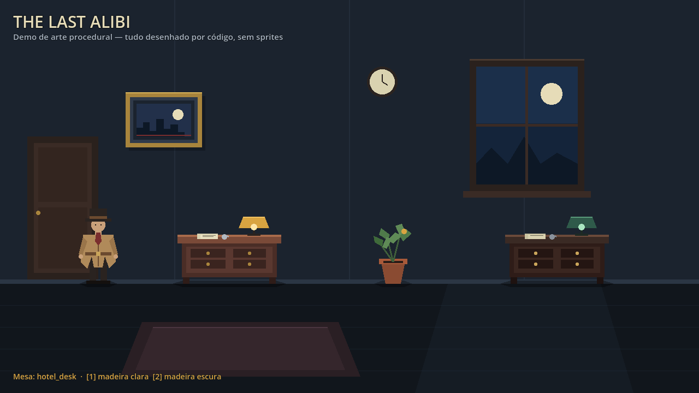
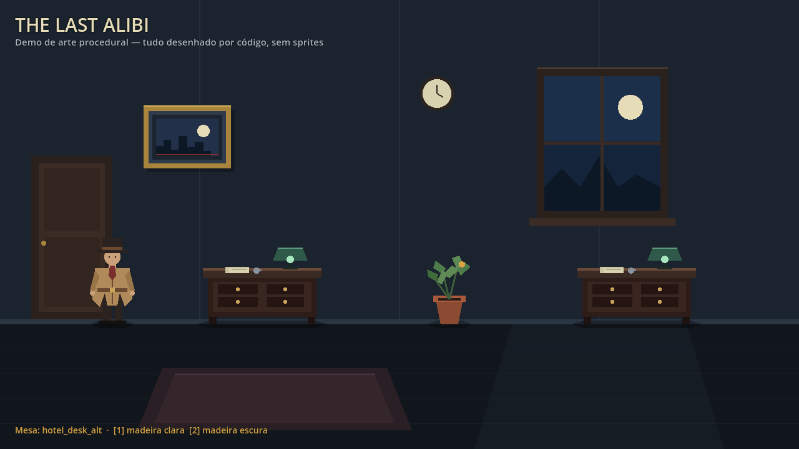

# The Last Alibi — Arte procedural via código

> **Status:** protótipo validado em 27/10/2026  
> **Escopo:** demonstração técnica; não é arte final  
> **Veredito curto:** funciona e ficou bom para protótipo; ainda é chapado demais para arte final.

## 1. Objetivo

O projeto deve conseguir produzir arte **sem depender de sprites, texturas ou imagens externas**. Cada objeto visual é descrito como dados matemáticos (retângulos, linhas, círculos e polígonos) e desenhado por um único renderizador.

Isso traz vantagens para um protótipo:

- não existe pipeline de importação de arte;
- mudanças de cor, tamanho e forma são feitas em dados versionáveis;
- o mesmo renderer serve para cenário, props e personagens;
- variantes visuais são trocadas sem código novo;
- o desenho é determinístico e fácil de revisar em diff.

As trocas são igualmente claras:

- o resultado é plano e geométrico;
- não há textura, gradiente, sombra suave ou animação pronta;
- formas complexas (mãos, tecido, folhagem densa) exigem muitos comandos;
- o estilo final precisa ser decidido de propósito, não apenas aceito como “placeholder”.

## 2. O que foi validado

- 6 definições de arte: fundo da sala, mesa clara, mesa escura, planta, quadro e detetive.
- 5 prefabs: mesa, mesa alternativa, planta, quadro e detetive.
- 1 renderer genérico usado por todos os objetos.
- 1 cena-demo em 1280×720.
- Cache de prefabs com reutilização, limite de pool e hooks de reset.
- 58 testes automatizados, em 12 suítes, todos passando.
- Capturas gráficas reais da demo, sem erros ou warnings de desenho.

## 3. Veredito visual: ficou bom ou feio?

**Não ficou feio.** Ficou um protótipo de *flat vector noir* limpo, legível e com identidade. Para a fase atual do projeto, é uma base boa. Para arte final, ainda é simples demais.

### O que funcionou

- **Paleta coerente:** parede azul-escura, piso quase preto, madeira quente, creme, verde e dourado.
- **Silhuetas legíveis:** o detetive, a mesa, a planta, o quadro, a janela e o relógio são reconhecíveis sem texto.
- **Composição equilibrada:** detetive à esquerda, mesa e planta no centro, segunda mesa e janela à direita.
- **Clima:** a luz fria da janela e os abajures criam uma atmosfera de apartamento à noite.
- **Variante data-driven:** a tecla **2** troca a mesa clara pela escura e o desenho muda de verdade, sem código específico para a variante.
- **Nitidez:** em 1280×720 as formas são vetoriais e nítidas; não há borrão de sprite.

### O que ficou fraco

- **Formas chapadas:** falta textura, gradiente, ruído e variação de material.
- **Sombras duras:** as sombras de contato são polígonos escuros; parecem barras, não sombras suaves.
- **Luz geométrica:** a luz da janela é um trapézio translúcido de borda dura.
- **Sem animação:** o detetive é estático; não há idle, caminhada, piscar ou respiração.
- **Cenário esparso:** é uma demonstração, não um apartamento completo.
- **UI com fonte padrão:** o título e a legenda usam a fonte padrão da Godot, sem tratamento tipográfico.
- **Sem interação:** a demo não tem colisão, scanner ou diálogo; isso continua separado no M1.

### Notas honestas

| Critério | Como protótipo | Como arte final |
|---|---:|---:|
| Legibilidade | 8/10 | 7/10 |
| Coerência de paleta | 8/10 | 7/10 |
| Identidade visual | 7/10 | 4/10 |
| Detalhe e acabamento | 6/10 | 3/10 |
| Potencial de animação | 7/10 | 5/10 |
| **Geral** | **8/10** | **4/10** |

**Recomendação:** manter o sistema e usá-lo para integrar uma sala real do jogo. Depois disso, decidir se o *flat vector noir* é a identidade final ou se o projeto precisa de texturas, pixel art ou shaders. O sistema não impede nenhuma dessas direções, mas hoje ele entrega propositalmente um visual de blocos coloridos.

## 4. Arquitetura

A solução separa três responsabilidades:

1. **`ProceduralArtDefinition`** — recurso de dados. Guarda `definition_id`, `logical_size`, `pivot` e `commands`.
2. **`ProceduralArtRenderer`** — nó `Node2D` genérico. Interpreta os comandos e executa `draw_rect`, `draw_line`, `draw_circle` e `draw_colored_polygon`.
3. **`ProceduralPrefabCache`** — nó opcional de ciclo de vida. Mantém `PackedScene` carregadas e reutiliza instâncias que saíram da árvore.

O renderer não conhece o jogo: não sabe o que é uma mesa, uma pista ou um suspeito. Ele apenas desenha. A lógica de investigação continua nos scripts de interação.

## 5. Arquivos no projeto

```text
res://
├── scripts/
│   └── procedural/
│       ├── procedural_art_definition.gd
│       ├── procedural_art_renderer.gd
│       ├── procedural_prefab_cache.gd
│       └── procedural_art_demo.gd
├── art/
│   └── definitions/
│       ├── room_background.tres
│       ├── hotel_desk.tres
│       ├── hotel_desk_alt.tres
│       ├── hotel_plant.tres
│       ├── hotel_painting.tres
│       └── detective.tres
├── scenes/
│   ├── props/
│   │   ├── hotel_desk.tscn
│   │   ├── hotel_desk_alt.tscn
│   │   ├── hotel_plant.tscn
│   │   ├── hotel_painting.tscn
│   │   └── detective.tscn
│   └── procedural/
│       └── procedural_art_demo.tscn
├── tools/
│   └── generate_procedural_art.gd
└── tests/
    ├── unit/test_procedural_art_definition.gd
    ├── unit/test_procedural_art_renderer.gd
    ├── unit/test_procedural_prefab_cache.gd
    ├── integration/test_procedural_art_demo_scene.gd
    └── fixtures/procedural_cache_probe.{gd,tscn}
```

## 6. Como as formas são definidas

`ProceduralArtDefinition` tem:

- `definition_id`: identificador legível para depuração.
- `logical_size`: tamanho de referência da peça. É metadado de organização; não recorta as formas.
- `pivot`: ponto local que fica alinhado com a posição do nó. Para personagens, use a base dos pés; para props, a base ou o centro.
- `commands`: lista ordenada de dicionários. Os últimos comandos ficam na frente.

### Tipos de comando suportados

| `type` | Campos | Resultado |
|---|---|---|
| `rect` | `position: Vector2`, `size: Vector2`, `color: Color`, opcional `filled: bool`, `width: float` | Retângulo preenchido ou contorno. |
| `line` | `from: Vector2`, `to: Vector2`, `color: Color`, opcional `width: float` | Linha sem antialiasing por padrão. |
| `circle` | `center: Vector2`, `radius: float`, `color: Color` | Círculo preenchido. |
| `polygon` | `points: PackedVector2Array`, `color: Color` | Polígono preenchido com pelo menos três pontos. |

As formas são desenhadas na ordem da lista. `Vector2` e `Color` podem ser definidos no Inspector ou por GDScript.

### Exemplo de definição

```gdscript
var art := ProceduralArtDefinition.new()
art.definition_id = &"hotel_reception_desk"
art.logical_size = Vector2i(160, 64)
art.pivot = Vector2(80, 64)
art.commands = [
    {
        "type": "rect",
        "position": Vector2(0, 12),
        "size": Vector2(160, 46),
        "color": Color("#382522"),
    },
    {
        "type": "rect",
        "position": Vector2(0, 8),
        "size": Vector2(160, 8),
        "color": Color("#bd9258"),
    },
]
```

Na demo, as definições são geradas por `tools/generate_procedural_art.gd` e salvas em `.tres`. O gerador é a fonte de verdade: edite os números e rode o script de novo.

## 7. Como criar um novo prefab

1. Crie uma definição nova e salve em `res://art/definitions/`.
2. Preencha `definition_id`, `logical_size` e `pivot`.
3. Adicione comandos do fundo para a frente.
4. Crie uma cena `.tscn` com um nó `Art` usando `ProceduralArtRenderer`.
5. Atribua a definição ao `Art`.
6. Adicione colisões e lógica de interação como nós separados.
7. Teste no tamanho real da resolução do jogo.

Estrutura recomendada para um objeto examinável:

```text
EvidenceHotelKey (Area2D)
├── CollisionShape2D
├── Art (Node2D + ProceduralArtRenderer)
└── EvidenceInteraction (script de lógica)
```

O renderer cuida apenas da apresentação. Ele não determina se uma chave é evidência, não abre diálogos e não administra o caso.

## 8. Cache de prefabs

`ProceduralPrefabCache` é opcional. Para usá-lo como Autoload:

1. Abra **Project > Project Settings > Globals > Autoload**.
2. Selecione `res://scripts/procedural/procedural_prefab_cache.gd`.
3. Use o nome de singleton **`PrefabCache`**.

### Adquirir e devolver

```gdscript
const HOTEL_DESK_SCENE := "res://scenes/props/hotel_desk.tscn"

func show_desk() -> Node:
    var desk := PrefabCache.acquire_prefab(HOTEL_DESK_SCENE, $World)
    if desk != null and desk is Node2D:
        (desk as Node2D).position = Vector2(420, 280)
    return desk

func hide_desk(desk: Node) -> void:
    if not is_instance_valid(desk):
        return
    PrefabCache.release_prefab(desk, HOTEL_DESK_SCENE)
```

A mesma chave deve ser usada na aquisição e na devolução. Chaves explícitas separam famílias:

```gdscript
var plant := PrefabCache.acquire_prefab(
    "res://scenes/props/hotel_plant.tscn",
    $World,
    &"lobby_plant"
)
PrefabCache.release_prefab(
    plant,
    "res://scenes/props/hotel_plant.tscn",
    &"lobby_plant"
)
```

O pool mantém no máximo `max_cached_instances_per_prefab` instâncias inativas por chave (padrão: 4). As excedentes são liberadas. `get_cached_instance_count()`, `clear_pool()` e `clear_all_pools()` ajudam a inspecionar e limpar os pools.

### Hooks de reset

O cache chama dois métodos opcionais no nó raiz do prefab:

- `on_procedural_cache_released()` antes de retirar o nó da árvore;
- `on_procedural_cache_acquired()` depois de adicioná-lo de volta.

Use-os para zerar animação, seleção, velocidade, timers e estado de interação.

## 9. A demo

Cena: `res://scenes/procedural/procedural_art_demo.tscn`.

- O fundo, as duas mesas, a planta, o quadro e o detetive usam o mesmo renderer.
- **1** volta para a mesa de madeira clara.
- **2** troca para a variante escura.
- Não há sprites, texturas ou imagens externas.
- A demo é separada do nível de investigação do M1; ela não substitui os placeholders do jogo.

### Capturas



*Demo padrão: mesa clara à esquerda, mesa escura à direita.*



*Após pressionar 2: a mesa da esquerda troca para a definição escura.*


*Após pressionar 1: o desenho volta à definição original.*

## 10. Validação em 8 passos

| Passo | Evidência | Resultado |
|---|---|---|
| 1. Renderizar uma mesa com poucos retângulos | `p0_default.png`; definição `hotel_desk.tres` | **Passou** |
| 2. Trocar a definição e ver o desenho mudar | tecla 2; `p1_variant_dark.png`; teste `test_demo_switches_desk_definition_by_variant` | **Passou** |
| 3. Criar três recursos diferentes com o mesmo renderer | 6 definições e 5 prefabs; teste `test_all_art_nodes_use_the_same_renderer_script` | **Passou** |
| 4. Instanciar o mesmo prefab duas vezes com posições independentes | teste `test_same_prefab_can_be_instantiated_twice_independently` | **Passou** |
| 5. Adquirir, devolver e adquirir de novo reutilizando a instância | teste `test_release_and_reacquire_reuses_same_instance` | **Passou** |
| 6. Devolver mais instâncias que o limite e conferir o pool | teste `test_pool_respects_limit` | **Passou** |
| 7. Testar hooks de reset em objeto com estado | fixture `procedural_cache_probe`; contadores de aquisição/liberação | **Passou** |
| 8. Abrir na resolução final e validar nitidez | capturas reais em 1280×720; sem erros ou warnings de desenho | **Passou** |

## 11. Testes automatizados

Resultado da suíte completa:

```text
== Resultado: 58 passaram, 0 falharam (12 suítes, 58 testes descobertos) ==
```

Antes da arte procedural, a suíte tinha 35 testes em 8 suítes. Foram adicionados **23 testes** em **4 suítes**:

| Suíte | Testes | Cobertura |
|---|---:|---|
| `test_procedural_art_definition.gd` | 5 | setters, clamp, `changed`, comandos e validade dos `.tres` |
| `test_procedural_art_renderer.gd` | 4 | avisos de configuração, definição, conversão de valores |
| `test_procedural_prefab_cache.gd` | 8 | aquisição, reutilização, limite, chaves, limpeza, hooks |
| `test_procedural_art_demo_scene.gd` | 6 | fundo, props, renderer único, posições, variantes, IDs |

O log da suíte tem apenas um warning preexistente e esperado do teste de evidência inexistente (`CaseSession`). Não há `ERROR`, `SCRIPT ERROR` ou erro de parse.

## 12. Desempenho e limites

- **Não há redesenho por frame.** O renderer só chama `queue_redraw()` quando a definição é atribuída ou alterada.
- **Evite milhares de primitivas por nó.** Para props pequenos, dezenas de comandos são suficientes. Meça antes de otimizar.
- **O recurso não cria colisões.** `CollisionShape2D`, `Area2D`, `StaticBody2D` e a lógica de interação continuam separados.
- **Não é pixel art automaticamente.** É desenho vetorial. Para pixel art real, use coordenadas em grade, paleta reduzida e configuração de filtro/estiramento adequada.
- **O cache aumenta a memória.** O limite por prefab evita acúmulo. Limpe pools em transições de capítulo.
- **Sem gradientes, arcos, elipses ou transformações por comando.** O renderer atual só tem `rect`, `line`, `circle` e `polygon`.
- **Sem texto dentro da arte.** A UI continua usando `Label` e `Button` da Godot.
- **Sem animação integrada.** Para animar, altere a definição e chame `touch()`/`queue_redraw()` apenas quando o quadro mudar.
- **Alta resolução ainda não testada.** Em 1280×720 o resultado é nítido; 1920×1080, 4K e Steam Deck precisam de validação.

## 13. Próximos passos recomendados

1. **Integrar uma sala real:** substituir os `Polygon2D` de placeholder do nível de investigação por definições procedurais pequenas para o investigador, o vidro, Mara e a saída.
2. **Criar um recurso de paleta/tema:** centralizar cores em um `.tres` para trocar a identidade visual sem editar cada definição.
3. **Adicionar animação:** idle do detetive, caminhada, piscar do abajur e variação da luz da janela, sempre com redraw sob demanda.
4. **Suavizar sombras e luz:** camadas de polígonos com alfa ou um shader simples para vinheta e luz volumétrica.
5. **Testar resoluções:** 1920×1080, 4K e Steam Deck; verificar nitidez de linhas e escala da UI.
6. **Decidir o estilo:** *flat vector noir* como identidade final ou base para pixel art/texturas. O sistema suporta as duas direções, mas elas exigem decisões diferentes de paleta, escala e animação.

## 14. Como reproduzir

```bash
cd /home/till/Projects/the-last-alibi

# suíte completa
./tests/run_tests.sh

# regerar as definições a partir do gerador
"/home/till/.local/share/Steam/steamapps/common/Godot Engine/godot.x11.opt.tools.64" \
  --headless --path . -s res://tools/generate_procedural_art.gd

# abrir a demo
"/home/till/.local/share/Steam/steamapps/common/Godot Engine/godot.x11.opt.tools.64" \
  --path . res://scenes/procedural/procedural_art_demo.tscn

# capturar as três imagens de evidência
./tests/manual/driver_procedural_art.sh
```

As capturas ficam em `tests/manual/screenshots/procedural-art/`.

## 15. Referências oficiais

- [CanvasItem — desenho 2D e `queue_redraw()`](https://docs.godotengine.org/en/stable/classes/class_canvasitem.html)
- [Desenho personalizado em 2D](https://docs.godotengine.org/en/stable/tutorials/2d/custom_drawing_in_2d.html)
- [Instâncias de cenas e `PackedScene`](https://docs.godotengine.org/en/stable/tutorials/scripting/nodes_and_scene_instances.html)
